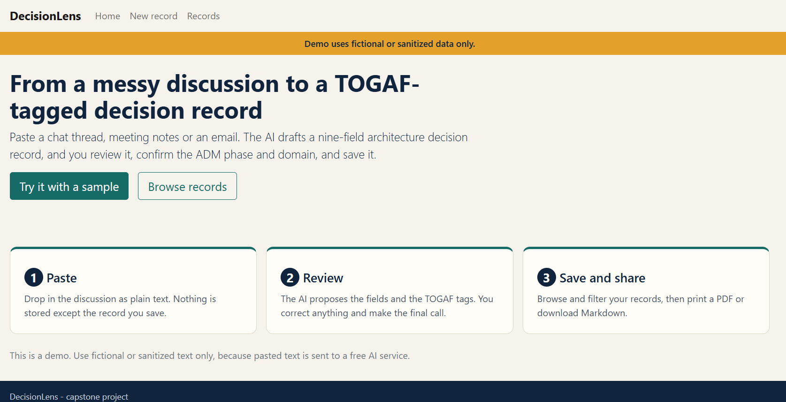
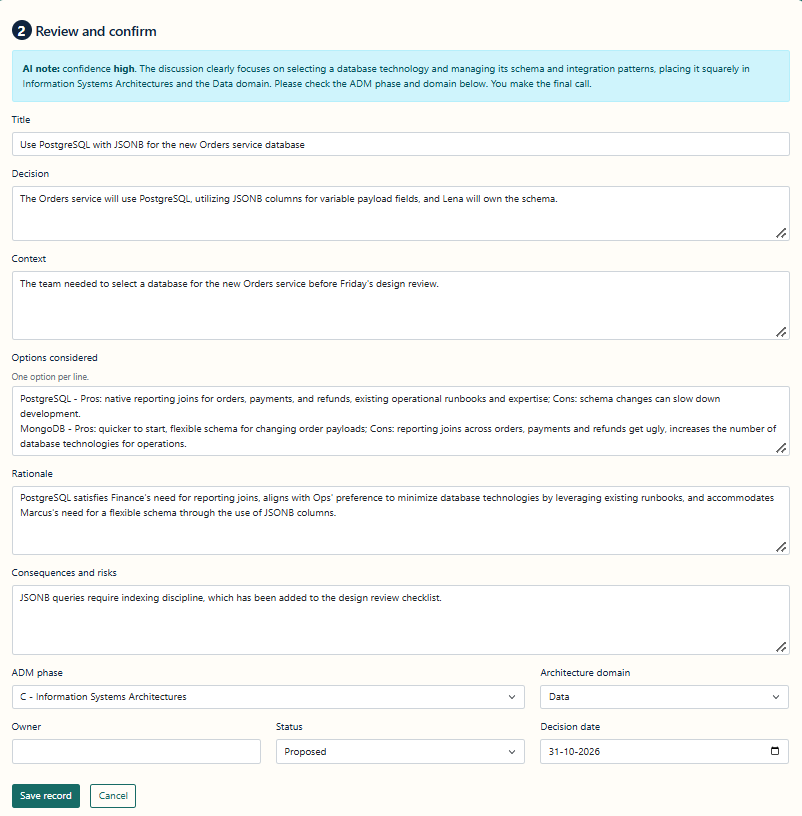
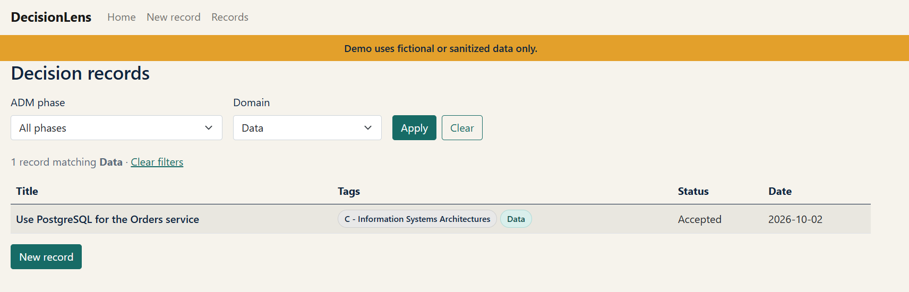

# DecisionLens

**Turn a messy architecture discussion into a TOGAF-tagged decision record in under a minute.**

[](https://github.com/debehera/DecisionLens/actions/workflows/ci.yml)

**Live demo:** https://decisionlens-xs40.onrender.com
(Free hosting: the first visit after a quiet period can take about a minute to wake up. Use fictional or sanitized text only.)



DecisionLens is a small web app for enterprise and solution architects. Architecture decisions usually happen in chat threads, meetings and email, and are never written down properly. DecisionLens takes that messy text, asks an AI to draft a nine-field decision record, and lets the architect review, correct and confirm it, including the TOGAF ADM phase and architecture domain, before it is saved.

It was built in ten days as a capstone for a TOGAF certification, using only free tools and services.

## How it works

1. **Paste** a chat thread, meeting notes or an email (or load one of the built-in fictional samples).
2. **Draft**: the AI proposes a nine-field record and suggests an ADM phase and domain, with a confidence note.
3. **Review**: the architect edits every field and confirms both TOGAF tags. The human always has the final say.
4. **Save and share**: browse and filter the records, then print a PDF or download Markdown.



## The TOGAF mapping

Every record is tagged with one of the ten **TOGAF ADM phases** (Preliminary, A to H, and Requirements Management) and one of the four **architecture domains** (Business, Data, Application, Technology). The AI suggests the tags, using short definitions of each phase in its prompt, and the architect confirms or corrects them. This makes a pile of decisions searchable by where they sit in the architecture method, not only by date.

The record itself has nine fields: title, decision, context, options considered, rationale, consequences and risks, ADM phase, architecture domain, and owner/status/date.

## Features

- Paste-to-draft with a Google Gemini model, behind a replaceable `IDecisionDrafter` interface.
- A validator that never trusts the model: it checks the JSON, matches the phase and domain to the allowed lists, and replaces anything missing with "Not stated in the discussion" so nothing is invented.
- Human review form with server-side validation of every dropdown value.
- Records list with filters by ADM phase and domain, shareable as URLs.
- Details, edit and delete (with a confirm dialog).
- Print view for "Save as PDF" and a Markdown download.
- AI guardrails: a 6,000-character input cap, a 10-second per-visitor cooldown and a global daily draft limit, with friendly messages for every failure.
- Four fictional sample discussions, including a deliberately thin one that tests that the AI does not make things up.
- No login and no stored discussions: only the record the architect saves is kept.
- Accessibility basics and a phone-friendly layout.



## Tech stack

| Area | Choice |
| --- | --- |
| App | ASP.NET Core 8, Razor Pages (server-rendered), plain JavaScript, Bootstrap |
| Data | Entity Framework Core 8 with Npgsql, PostgreSQL |
| AI | Google Gemini API (free tier), `gemini-3.5-flash-lite` |
| Hosting | Render free web service (Docker) and free PostgreSQL, Singapore region |
| Tests | xUnit (29 unit tests), GitHub Actions for build and test |

The architecture documents (vision, business capability map, gap analysis and ten Architecture Decision Records) are in [`docs/architecture`](docs/architecture/README.md). The project documents its own decisions the way the product asks its users to.

## Run it locally

Prerequisites: the [.NET 8 SDK](https://dotnet.microsoft.com/download/dotnet/8.0), a PostgreSQL database (a free Render Postgres works) and a free Gemini API key from [Google AI Studio](https://aistudio.google.com).

```powershell
git clone https://github.com/debehera/DecisionLens.git
cd DecisionLens\DecisionLens.Web

dotnet user-secrets set "ConnectionStrings:Default" "<postgres URL or Npgsql connection string>" | Out-Null
dotnet user-secrets set "Ai:ApiKey" "<your Gemini API key>" | Out-Null
dotnet user-secrets set "Ai:Model" "gemini-3.5-flash-lite" | Out-Null

dotnet run
```

Open http://localhost:5163. On first start the app applies the database migrations and adds four fictional seed records. Secrets stay in your user-secrets store and are never committed.

Run the tests from the solution folder:

```powershell
dotnet test
```

## Configuration

Settings come from `appsettings.json`, user-secrets locally, or environment variables on the host (a double underscore replaces the colon).

| Setting | Environment variable | Default | Notes |
| --- | --- | --- | --- |
| `ConnectionStrings:Default` | `ConnectionStrings__Default` | none | Secret. Accepts a `postgres://` URL or a standard Npgsql string |
| `Ai:ApiKey` | `Ai__ApiKey` | none | Secret |
| `Ai:Model` | `Ai__Model` | none | Gemini model name |
| `Ai:TimeoutSeconds` | `Ai__TimeoutSeconds` | 40 |  |
| `Limits:MaxInputChars` | `Limits__MaxInputChars` | 6000 | Checked in the browser and on the server |
| `Limits:DailyDraftLimit` | `Limits__DailyDraftLimit` | 40 | Global, per UTC day |
| `Limits:CooldownSeconds` | `Limits__CooldownSeconds` | 10 | Per visitor, in memory |

## Deployment

The app runs on Render as a free Docker web service built from the `Dockerfile` in this repository. It reads the `PORT` variable, trusts the proxy's forwarded headers (so the visitor address is correct) and exposes `/healthz` for the health check. Form-protection keys are stored in the database so open pages survive a restart. Migrations run on startup.

## Important notes

- **Use fictional or sanitized text only.** Pasted text is sent to a free AI provider. DecisionLens does not store it, and it is not written to the logs, but it does leave the app.
- **Cold start.** The free Render web service sleeps when idle. Open the site a few minutes before a demo.
- **Free database expiry.** The free Render PostgreSQL database was created on Oct 23, 2026 and expires 30 days after creation (around Nov 22, 2026), with a 14-day grace period. Export any records you want to keep first, or create a new free database and update `ConnectionStrings__Default`.
- There is no login: everyone with the link shares one list of records.

## Known issues and what's next

See [`docs/KNOWN-ISSUES.md`](docs/KNOWN-ISSUES.md), [`docs/future-scope.md`](docs/future-scope.md) and the [30-day growth plan](docs/30-day-growth-plan.md). The story of how the project was built is in the [challenge retrospective](docs/challenge-retrospective.md), and a three-minute demo script is in [`docs/DEMO.md`](docs/DEMO.md).

## Author

Built by **Debraj Behera**, lead application developer and TOGAF-certified practitioner, as a ten-day capstone with Claude as the AI pair programmer.

Licensed under the [MIT License](LICENSE).
