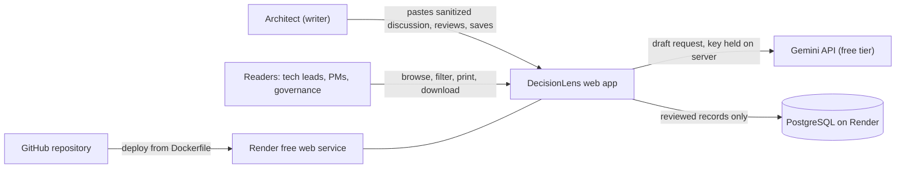

# DecisionLens: Architecture Vision, Business Context and Strategy

| Item | Value |
| --- | --- |
| TOGAF phase | Preliminary and Phase A (Architecture Vision), with a summary of Phases B to D |
| Version | 1.0 (written on Day 1, Tue Oct 20, 2026) |
| Source documents | `docs/DecisionLens Product Requirements Document.md`, `docs/DecisionLens Implementation Blueprint (Days 2-10).md` |
| Status | Accepted for the capstone |

## 1. Purpose

This document records the business context, strategy, stakeholders, principles and constraints behind DecisionLens, in the shape of a TOGAF Architecture Vision. It explains why the product exists and which decisions were fixed before any code was written. The detailed requirements are in the PRD and the build plan is in the Implementation Blueprint.

## 2. Business context

### 2.1 The business problem

Architecture decisions are made in chat threads, meetings, email and ticket comments. They are rarely written down in a usable form. Months later nobody can say why a system was built the way it was. This is often called architectural amnesia.

Discovery showed that the root cause is **extraction, not a missing template**. A long thread contains the options considered, the arguments, the final call and the owner, all buried in conversation. Pulling the decision out takes time that architects and tech leads do not have, so it is skipped.

### 2.2 Who feels it

| Group | Effect today |
| --- | --- |
| Enterprise and solution architects | Cannot show governance a traceable record of why a choice was made |
| Tech leads and developers | Have to ask around to understand an existing design |
| Project managers and product owners | Do not know what was decided or what it costs |
| Governance reviewers | Cannot audit phase, domain, owner, status and date |

### 2.3 Business drivers

1. Governance needs traceability for architecture decisions.
2. Settled debates get reopened when nobody can find the original reasoning.
3. New team members need to learn why, not only what.
4. Writing records by hand from messy discussions is slow, so it does not happen.

## 3. Business strategy

### 3.1 Vision

Every architecture decision captured in minutes, tagged to TOGAF, and findable years later.

### 3.2 Strategy in one paragraph

Remove the effort of extraction. The architect pastes the discussion, an AI drafts a structured record, and the architect confirms it. The TOGAF mapping (ADM phase and architecture domain) is the differentiator, because it ties each decision to the framework governance already uses. The strategy is to prove this one workflow end to end, at zero running cost, before adding search, linking or integrations.

### 3.3 Goals and objectives

| # | Goal | Objective for v1.0 | Measure |
| --- | --- | --- | --- |
| G1 | Cut the effort of writing a decision record | Paste, review and save replaces manual rewriting | An AI draft returns in under 30 seconds in typical use |
| G2 | Make every record governance-grade | ADM phase and domain on every record, confirmed by a human | No record can be saved without both tags |
| G3 | Ship a small, polished product | One workflow done well, deployed by Thu Oct 29, 2026 | A stranger completes the workflow on the live link without help |
| G4 | Keep cost at zero | Free AI key, free hosting, no paid tools | Monthly cost of $0 |

### 3.3.1 What success looks like on Day 10

A live public link where a stranger can open a built-in sample discussion, get an AI-drafted and TOGAF-tagged record, edit and save it, filter the list and export it. The product owner can also run the same flow as a demo, and the pitch deck is ready.

## 4. Stakeholders and concerns

| Stakeholder | Role | Key concerns | Architecture viewpoint |
| --- | --- | --- | --- |
| Enterprise or solution architect | Primary user (writer) | Speed; accurate extraction; easy tag correction; control of final wording | Process and application |
| Tech lead or developer | Reader | Clear context and rationale | Application |
| Project manager or product owner | Reader | What was decided, consequences | Business |
| Governance reviewer | Reader | Traceability: phase, domain, owner, status, date | Business and data |
| Capstone evaluator or stranger on the public link | Evaluator | Works without explanation; safe to try | Application and technology |
| Product owner and builder | Sponsor and builder | Fits 13 build hours; zero cost; reuses existing skills | All |

## 5. Architecture principles

| ID | Principle | Rationale | Implications |
| --- | --- | --- | --- |
| P1 | The AI proposes, the architect decides | A black box is not acceptable in governance | The two TOGAF tags and every field are editable; nothing is saved without confirmation; owner, status and date are never filled by the AI |
| P2 | One workflow done well | 13 build hours cannot support many features | Scope is fixed; extra ideas go to future scope; a cut list exists |
| P3 | Zero cost to run | Budget is zero and no paid tools are allowed | Free AI tier, free hosting and database; limits are handled gracefully |
| P4 | Use skills already in hand | Learning time is the scarcest resource | C#, SQL, HTML and CSS; minimal plain JavaScript; no front-end framework |
| P5 | Store only what is needed | The pasted text may be sensitive | The pasted discussion is never saved; only the reviewed record is stored |
| P6 | Keep the AI provider replaceable | Free tiers change without notice | The AI sits behind an interface; model name and limits live in configuration |
| P7 | Fictional or sanitized data only | Free AI tiers may use submitted text | A visible banner; the README states the rule; seed data is fictional |

## 6. Constraints and assumptions

| Type | Item |
| --- | --- |
| Time | 13 build hours over Days 2 to 10: 1 hour on weekdays, 3 hours on Saturday and Sunday |
| Budget | No paid tools or services |
| Skills | Strong in C#, SQL, HTML, CSS, API calls and deployment; new to JavaScript |
| Hosting | Render free tier: the app sleeps after inactivity and the first visit can take about a minute |
| Database | Render free PostgreSQL has an expiry period; the demo plan accounts for it |
| AI | Free-tier limits and terms can change; they are re-checked on the day the key is created |
| Access | No login; everyone with the link sees one shared list |
| Assumption | One shared list is acceptable because no real data is entered |

## 7. Scope

**In scope for v1.0:** paste text from any source; AI-drafted nine-field record with ADM phase and domain suggestions; human review and editing; manual "start blank" path; record list, record page, filter by phase and domain, edit and delete; print view and Markdown download; built-in samples and seeded fictional records; guardrails (input cap, daily limit, cooldown, friendly errors); public deployment on a free host.

**Left out of v1.0:** keyword search, summary dashboard, linking or superseding decisions, user accounts, Teams, Slack, Jira or email integrations, Word or generated PDF, file upload, version history.

## 8. System context

## 9. Architecture summary by domain (Phases B to D)

| Domain | Summary | Detail |
| --- | --- | --- |
| Business | Architecture decision management: capture, classify, govern, share. One writer role and several reader roles | `02-business-capability-map.md` |
| Data | One entity, the decision record, with nine fields plus system fields; a small table for the daily AI usage counter. The source discussion is not stored | Blueprint, "Data model" |
| Application | Server-rendered ASP.NET Core Razor Pages; one JSON endpoint for the AI draft; an AI drafter behind an interface with server-side validation | Blueprint, "Technology stack", "AI contract", "Routes and screens" |
| Technology | .NET, PostgreSQL with Entity Framework Core, Gemini REST API, Docker on Render, GitHub | Blueprint, "Technology stack"; ADRs 0003 to 0009 |

## 10. TOGAF ADM mapping for this capstone

| ADM phase | Applied to DecisionLens | Where it is documented |
| --- | --- | --- |
| Preliminary | Principles, constraints, ways of working | Sections 5 and 6 of this document |
| A. Architecture Vision | Vision, drivers, goals, stakeholders, scope | This document |
| B. Business Architecture | Capability map for architecture decision management | `02-business-capability-map.md` |
| C. Information Systems Architectures | Data model, application design, AI contract | Blueprint; ADRs 0003, 0004, 0005, 0007, 0010 |
| D. Technology Architecture | Runtime, database, hosting, secrets, deployment | Blueprint; ADRs 0004, 0009 |
| E. Opportunities and Solutions | Candidate options compared and one chosen | Options sections of each ADR |
| F. Migration Planning | Ten-day plan with daily proofs and gates | Blueprint, "Calendar and time budget" |
| G. Implementation Governance | Gates, checklists, tests and the ADRs themselves | Blueprint gates; `adr/` |
| H. Architecture Change Management | Future scope and the rule that changes go through a new ADR | `03-gap-analysis.md`, section 5 |
| Requirements Management | Traceability from requirements to days | PRD; Blueprint calendar |

## 11. Risks

| Risk | Likelihood | Impact | Mitigation |
| --- | --- | --- | --- |
| Free AI limits, terms or models change | Medium | High | AI behind an interface; check limits when the key is created; fallback provider; manual "start blank" path always works |
| AI suggests the wrong phase or domain | Medium | Medium | Mandatory human confirmation; AI note shows confidence and reason |
| AI invents details | Medium | High | Prompt forbids invention; gaps read "Not stated in the discussion" |
| Only 13 build hours | High | High | One workflow; single-purpose weekday sessions; fixed cut list |
| JavaScript is new | Medium | Medium | Plain JavaScript limited to a few small behaviors |
| Free host sleeps; free database expires | Certain | Low | Warm-up step before demos; database created in time and rebuildable |
| Strangers use up the AI quota | Medium | Medium | Input cap, daily limit, cooldown, friendly limit message |
| Confidential text pasted | Low | High | Visible banner; source text never stored; stated in the README |
