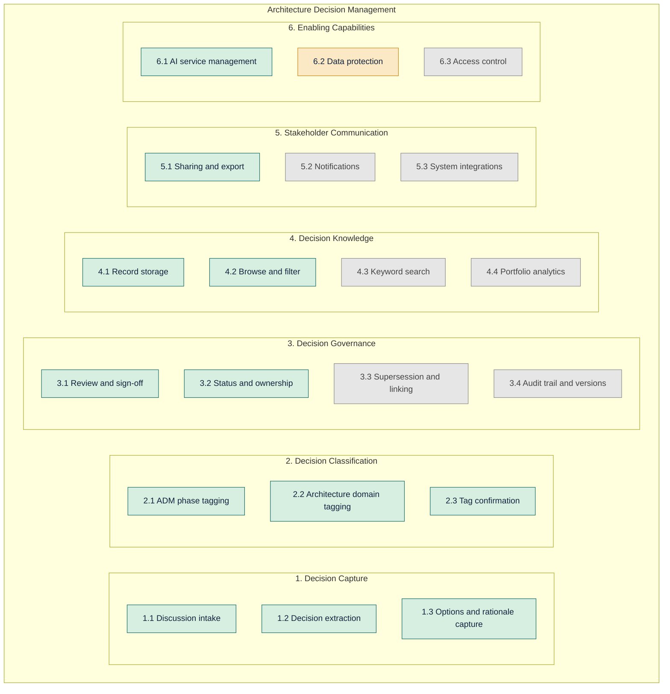
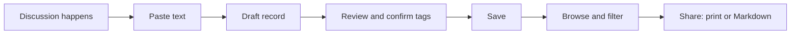

# DecisionLens: Business Capability Map

| Item | Value |
| --- | --- |
| TOGAF phase | B. Business Architecture |
| Subject | The business function DecisionLens supports: architecture decision management |
| Version | 1.0 (Day 1, Tue Oct 20, 2026) |

## 1. How to read this map

A business capability describes **what** an organisation can do, independent of **how** or **with which tool**. This map covers the architecture decision management function of an architecture practice. It shows which capabilities DecisionLens v1.0 delivers, which it supports partly, and which are deliberately left for later.

Colour key in the diagram and the "v1.0 coverage" column:

- **Delivered:** the capability works end to end in v1.0.
- **Partial:** v1.0 covers part of it; the rest is manual or left out.
- **Future:** deliberately outside v1.0.

## 2. Capability map

A PNG copy is in `capability-map.png`, for slides and documents. GitHub also shows the diagram above automatically. In other viewers, paste the code block into <https://mermaid.live>.

## 3. Capability catalogue

Baseline describes the situation before DecisionLens, as found in discovery on Day 1.

| ID | Capability | What it means | Baseline today | v1.0 coverage | How v1.0 delivers it |
| --- | --- | --- | --- | --- | --- |
| 1.1 | Discussion intake | Take in discussion text from any source | Discussions live in chat, meetings, email and tickets | Delivered | Paste text; sources are treated as plain text, so no integrations |
| 1.2 | Decision extraction | Pull the decision, context and owner out of noisy text | Manual, slow, usually skipped | Delivered | AI drafts the fields from the pasted text |
| 1.3 | Options and rationale capture | Record alternatives and why one won | Rarely recorded | Delivered | Options and rationale are fields in the record; gaps read "Not stated in the discussion" |
| 2.1 | ADM phase tagging | Link a decision to a TOGAF ADM phase | Not done | Delivered | AI suggests one of the ten phases; architect confirms |
| 2.2 | Architecture domain tagging | Link a decision to Business, Data, Application or Technology | Not done | Delivered | AI suggests one domain; architect confirms |
| 2.3 | Tag confirmation | A human validates the classification | Not applicable | Delivered | Dropdowns on the review form; saving requires both tags |
| 3.1 | Review and sign-off | A responsible person approves the record | Informal | Delivered | Architect reviews and edits every field before saving. There is no multi-person approval workflow |
| 3.2 | Status and ownership | Who owns it and where it stands | Not tracked | Delivered | Owner, status (Proposed, Accepted, Rejected, Superseded) and date on every record |
| 3.3 | Supersession and linking | Show which decision replaces or relates to another | Not done | Future | The Superseded status can be set, but records cannot yet be linked |
| 3.4 | Audit trail and versions | Keep a history of changes | Not done | Future | Version history is out of scope |
| 4.1 | Record storage | Keep records in one place | Scattered or absent | Delivered | PostgreSQL database; one shared list |
| 4.2 | Browse and filter | Find records by structure | Not possible | Delivered | List page with filters by ADM phase and domain |
| 4.3 | Keyword search | Find records by words | Not possible | Future | Out of scope for v1.0 |
| 4.4 | Portfolio analytics | See patterns across decisions | Not possible | Future | Dashboard is out of scope |
| 5.1 | Sharing and export | Give a record to stakeholders | Manual copy and paste | Delivered | Print view (save as PDF from the browser) and Markdown download |
| 5.2 | Notifications | Tell people a decision was made | Informal | Future | Out of scope |
| 5.3 | System integrations | Connect to Teams, Slack, Jira, email | Not applicable | Future | Out of scope; pasting covers all sources |
| 6.1 | AI service management | Keep the AI usable, safe and affordable | Not applicable | Delivered | Interface for the provider; input cap, daily limit, cooldown, friendly errors |
| 6.2 | Data protection | Protect sensitive text | Not applicable | Partial | Source text is never stored and a banner asks for fictional or sanitized text. The text is still sent to a free AI provider, so real confidential data must not be used |
| 6.3 | Access control | Control who can see and change records | Not applicable | Future | No login in v1.0; everyone with the link shares one list |

## 4. Coverage summary

| Coverage | Count | Capabilities |
| --- | --- | --- |
| Delivered | 12 | 1.1, 1.2, 1.3, 2.1, 2.2, 2.3, 3.1, 3.2, 4.1, 4.2, 5.1, 6.1 |
| Partial | 1 | 6.2 |
| Future | 7 | 3.3, 3.4, 4.3, 4.4, 5.2, 5.3, 6.3 |

The roadmap for the remaining gaps is in `03-gap-analysis.md`.

## 5. Value stream (how the capabilities work together)

| Stage | Capabilities involved |
| --- | --- |
| Paste text | 1.1, 6.1 |
| Draft record | 1.2, 1.3, 2.1, 2.2, 6.1 |
| Review and confirm tags | 2.3, 3.1, 3.2 |
| Save | 4.1 |
| Browse and filter | 4.2 |
| Share | 5.1 |

## 6. Organisation and roles

| Role | Capabilities used |
| --- | --- |
| Enterprise or solution architect (writer) | 1.1 to 1.3, 2.1 to 2.3, 3.1, 3.2, 4.1, 4.2, 5.1 |
| Tech leads, project managers, product owners | 4.2, 5.1 |
| Governance reviewer | 3.2, 4.2, 5.1 |
